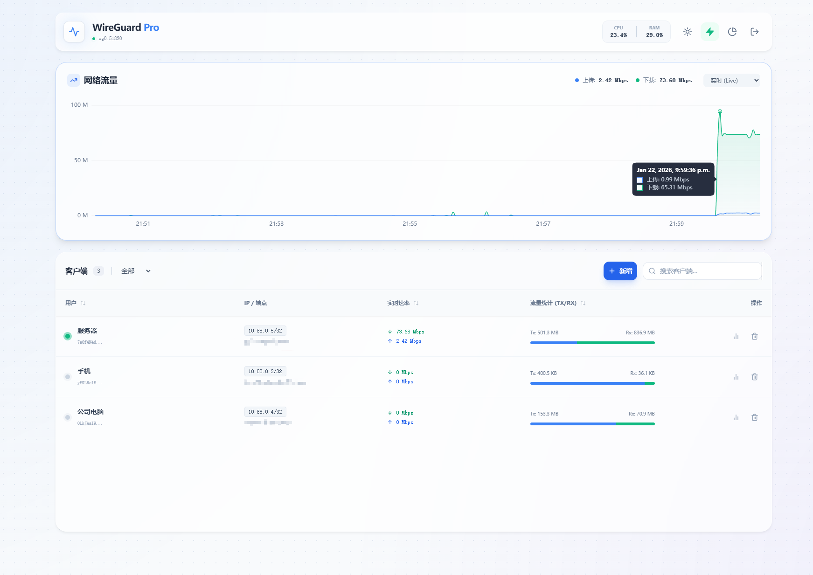

# ⚡ WireGuard Pro Dashboard (Single-Binary Lightweight Edition)

[](https://golang.org/doc/devel/release.html)

[](https://vuejs.org/)
[](https://tailwindcss.com/)
[](https://modernc.org/sqlite)
[](#)

**零外部依赖 · 单二进制 · 高性能实时可视化 WireGuard 管理平台**

[核心特性](#-核心特性) • [架构优势](#-架构优势) • [快速开始](#-快速开始) • [Mock沙盒模式](#-mock沙盒模拟模式) • [配置参数](#-配置参数) • [Docker部署](#-docker-部署)

---



> [!NOTE]
> **全新轻量化架构升级**: 彻底剥离了对外部 **MySQL**、**Redis** 及本地 **GeoLite2 (.mmdb)** 的强制依赖！采用**纯 Go 内嵌 SQLite (WAL 模式) + 进程内并发 EventBus + 内存缓存 + //go:embed 单二进制全内置打包**。开箱即用，无任何安装门槛。

---

## ✨ 核心特性

### 🚀 零外部依赖单二进制 (Single-Binary Architecture)
* **嵌入式存储**: 基于纯 Go 实现的 SQLite（无需 CGO，`CGO_ENABLED=0` 完美静态编译），内置 WAL 模式与自动归档/降采样/过期清理。
* **Go 原生内存引擎**: 原生 `chan` + `sync.Map` 实现微秒级进程内 Pub/Sub 事件总线（EventBus）与带 TTL 淘汰的内存缓存，完全取代外部 Redis。
* **免配置静态打包**: 前端 HTML、CSS、JS（Vue 3、ECharts、Tailwind、Leaflet 等全部库）完整嵌入二进制文件，随时随地单文件运行。
* **GeoIP 优雅降级**: 本地未提供 GeoLite2 mmdb 文件时，自动优雅降级为在线 API 查询 + 进程内存缓存，永不报错。

### 🛡️ 宿主机环境安全与 Mock 沙盒层 (MockExecutor)
* **安全沙盒隔离**: 在非 Linux root 环境或开启 `-mock` 时，自动进入 Mock 模式，在内存中模拟接口状态、Peer 列表、流量自动增长、Ping RTT 与路由追踪。
* **绝对安全**: 所有文件读写限制在项目内部 `./.sandbox_data/` 目录中，严禁改动宿主机 `/etc/`、`/var/` 或底层网络规则。

### 📊 深度分析与审计 (Advanced Analytics)
* **智能健康度评估**: 综合考量活跃度、丢包率、延迟与在线时长评分。
* **行为画像与全局热力图**: 7x24 小时活跃时段与最佳连接时间窗口自动推荐。
* **高频秒级监控**: 毫秒级 SSE 实时推送流量带宽变化。

### 🛠️ 完善的客户端配置管理
* **一键管理**: 轻松创建、启用/禁用、删除 Peer，支持客户端配置与二维码导出。
* **IP 自动建议**: 智能扫描网段空闲地址，自动推荐未占用的 `/32` IP。
* **热重载**: 动态更新 WireGuard 配置，连接不中断。

---

## 🛠️ 技术栈对比

| 组件 | 原版本 | 当前单二进制轻量版 | 优势 |
| :--- | :--- | :--- | :--- |
| **存储层** | 外部 MySQL 服务 | 纯 Go 内嵌 SQLite (WAL) | 零安装，自动降采样，单文件归档 |
| **消息广播** | 外部 Redis Pub/Sub | 进程内 EventBus | 微秒级延迟，零网络开销，零维护 |
| **缓存层** | 外部 Redis Hash | 内存 TTL 并发缓存 | 消除外部连接抖动，内存占用极低 |
| **静态资源** | 磁盘目录文件依赖 | `//go:embed` 全嵌入 | 单一可执行文件直接分发运行 |
| **GeoIP** | 强依赖本地 mmdb | 本地 mmdb + 在线 API + 内存回退 | 开箱即用，免配置 |
| **宿主机测试** | 需 root 及真实网卡 | 抽象接口 + MockExecutor | 任意开发机（Win/Mac/Linux）一键自测 |

---

## 🚀 快速开始

### 1. 源码编译 (纯 Go，无需 GCC/CGO)

```bash
# 1. 克隆代码
git clone https://github.com/yourusername/wg-dashboard.git
cd wg-dashboard

# 2. 静态编译 (零 C 依赖)
CGO_ENABLED=0 go build -o wg-dashboard .
```

### 2. 运行

#### 生产模式 (需要 Linux Root 权限)
```bash
sudo ./wg-dashboard -password "your_admin_password" -secret "your_jwt_secret_16chars"
```

#### 沙盒/模拟模式 (开发测试使用，非 Root、无 WireGuard 即可运行)
```bash
./wg-dashboard -mock -password "test_admin_password" -secret "test_jwt_secret_16chars"
```

---

## 🐳 Docker 部署

使用提供的极简 `docker-compose.yml`，无需额外数据库或缓存容器：

```bash
docker compose up -d
```

默认访问地址: `http://<服务器IP>:18080`

---

## ⚙️ 配置参数与环境变量

| 参数 Flag | 环境变量 | 默认值 | 说明 |
| :--- | :--- | :--- | :--- |
| `-port` | `PORT` | `:18080` | Web 服务监听地址与端口 |
| `-iface` | `WG_IFACE` | `wg0` | WireGuard 网络接口名称 |
| `-password` | `WG_ADMIN_PASSWORD` | *(必填)* | 仪表盘登录管理员密码 |
| `-secret` | `WG_JWT_SECRET` | *(必填)* | JWT 签名密钥 (长度 >= 16 位) |
| `-db` | `WG_DB_PATH` | `./.sandbox_data/wg_dashboard.db` | SQLite 数据文件存放路径 |
| `-config-dir` | `WG_CONFIG_DIR` | `/etc/wireguard` 或沙盒路径 | WireGuard `.conf` 配置文件所在目录 |
| `-days` | `WG_RETENTION_DAYS` | `30` | 历史流量日志保留天数 |
| `-mock` | `WG_MOCK` | `false` | 启用 Mock 沙盒模拟模式（不触碰宿主机） |
| `-geo-city` | - | `./GeoLite2-City.mmdb` | 可选 GeoLite2 City 数据库路径 |
| `-geo-asn` | - | `./GeoLite2-ASN.mmdb` | 可选 GeoLite2 ASN 数据库路径 |

---

## 🧪 单元测试与基准测试

本项目具备完善的自动化测试与沙盒隔离防护：

```bash
# 运行完整测试套件
CGO_ENABLED=0 go test -v ./...
```
